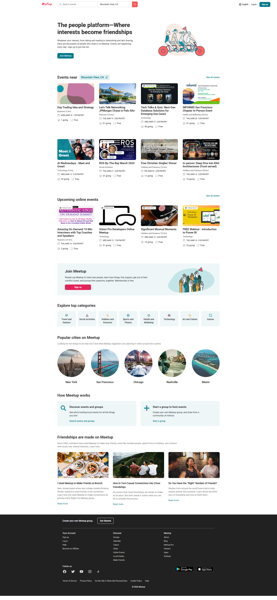
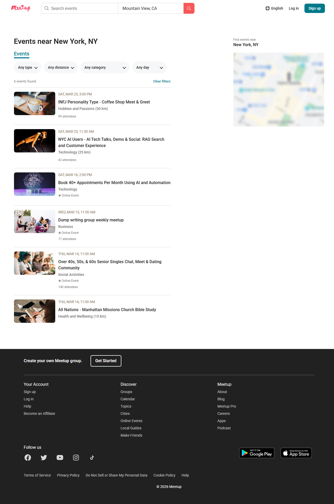
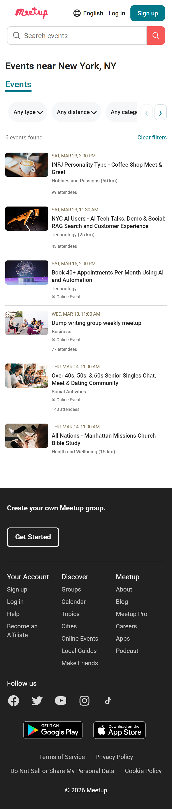

# Meetup — учебный frontend-проект

**Русский** · [English](#english)

Адаптивный двухстраничный сайт по макету Figma, созданный для итогового проекта frontend-модуля. Реализован на HTML, CSS и JavaScript без фреймворков и сборщиков.

## Возможности

- Главная страница с мероприятиями, категориями, городами и информационными разделами.
- Страница `filterPage.html` с шестью мероприятиями из учебного задания.
- Совместная фильтрация по типу, категории, максимальному расстоянию и календарному дню.
- При выборе **Online** фильтр расстояния становится недоступным; прежний выбор сохраняется и снова применяется после смены типа.
- Сброс фильтров, количество найденных мероприятий и сообщение при отсутствии результатов.
- Адаптивная вёрстка, локальные SVG-иконки и статическая карта из макета.
- На мобильных экранах — горизонтальная прокрутка фильтров свайпом и стрелками; карточки категорий подсвечиваются при наведении мышью.

## Технологии

HTML5, CSS3 (Flexbox, Grid, media queries), JavaScript (DOM, массивы, `filter()`, обработчики событий), Git и GitHub.

## Опубликованная версия

[Открыть сайт на GitHub Pages](https://pavel3329.github.io/meetup-final_project/)

## Запуск

1. Откройте папку проекта в VS Code.
2. Запустите `index.html` через расширение **Live Server**.
3. Перейдите на страницу мероприятий кнопкой **Join Meetup**.

Также можно открыть `index.html` напрямую в браузере.

Установка пакетов не требуется. Для загрузки изображений шести мероприятий на странице фильтрации необходимо интернет-соединение.

## Структура

```text
├── index.html                 # Главная страница
├── filterPage.html           # Страница фильтрации
├── styles/
│   ├── common.css            # Общие стили и навигация
│   ├── main.css              # Разделы главной страницы и футер
│   ├── event-card.css        # Общие карточки мероприятий
│   └── filter.css            # Фильтры, список и карта
├── scripts/
│   ├── homeEvents.js         # Данные и карточки главной страницы
│   ├── eventsData.js         # Шесть объектов задания
│   └── filter.js             # Фильтрация и создание карточек
└── assets/
    ├── images/               # Изображения и статическая карта
    └── icons/                # SVG-иконки
```

## Макет и изображения

[Figma — Front-end project](https://www.figma.com/design/dWkhtgag438U7CW15rtFxx/Front-end-project--Copy-?node-id=0-1)






## Статус

Обе страницы реализованы. Адаптивность проверена вручную на разных ширинах экрана. Поиск и карта остаются демонстрационными элементами.

---

## English

A responsive two-page Meetup-inspired website built for a frontend course final project using **HTML5, CSS3, and vanilla JavaScript**. No framework or build step is required.

### Features

- Responsive homepage with events, categories, cities, and editorial sections.
- Events page rendering six assignment-provided objects with combined filters for **type, category, maximum distance, and date**.
- Distance filtering is disabled for online events; the previous distance selection is preserved when switching back.
- Reset button, result count, empty-state message, a static map preview, and horizontal mobile filter scrolling with touch and arrow controls.

### Live demo

[Open the site on GitHub Pages](https://pavel3329.github.io/meetup-final_project/)

### Run locally

Open the project in VS Code and launch `index.html` with **Live Server**. Select **Join Meetup** to navigate to the events page. An internet connection is needed for the six externally hosted images on the filter page.

### Project files

`index.html` and `filterPage.html` are the two pages; `styles/` contains shared and page-specific CSS; `scripts/homeEvents.js` handles homepage cards, `scripts/eventsData.js` stores the six events, and `scripts/filter.js` renders and filters the events list. Assets are stored in `assets/`.

### Design and status

[Figma design](https://www.figma.com/design/dWkhtgag438U7CW15rtFxx/Front-end-project--Copy-?node-id=0-1). Both pages are implemented. Responsive behavior has been manually checked at multiple widths. Search and the map remain demonstration-only elements. Four screenshots are included above.
